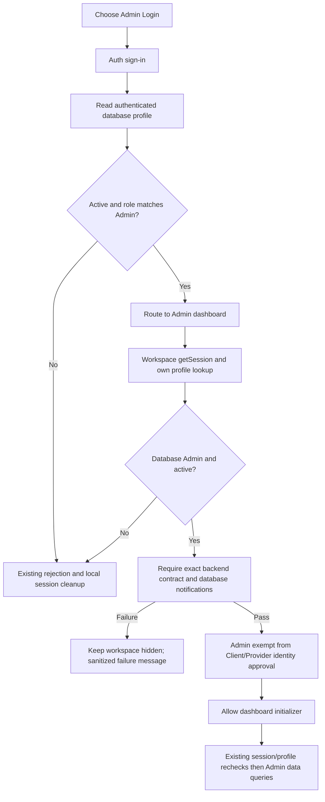

# Admin access diagnosis and safe next action

Review date: 1 November 2026 (Asia/Kuala_Lumpur). Base: `feat/password-recovery-experience`, reviewed PR #15 commit `6b7704124cdfc9dbb9b1838927820ffe1a9fad39`. Fix branch: `fix/admin-access-diagnostics`. No live project was contacted, no SQL executed and no deployed application changed.

## Finding: incompatible frontend/backend, plus a misleading catch message

The checked-in `igotu_v2/js/supabaseClient.js` points at production `giqtnbwyktbnbhdvjraa`. `backend-access.js` requires the exact `20261026.1` contract **and** `notifications: "database"`. The user supplied independent SELECT-only metadata showing `igotu_backend_contract()`, `provider_service_requests()`, `service_participants()` and `recommended_provider_candidates()` absent in production and present in staging. We did not repeat production inspection.

Given that evidence, even a legitimate active Admin cannot complete this frontend's compatibility check against production. This is a sufficient blocker, not proof that the account passed earlier checks or that it has the Admin database role. The reported error alone cannot identify which check actually failed: the previous broad catch mapped session, profile, compatibility and identity-query failures to the same approval message.

`igotu_backend_contract()` is installed near the end of coordinated D04 and checks the private installation's phase 4. Installing only a version-returning function would misrepresent compatibility; it would leave reader/mutation/policy/notification/Storage dependencies unresolved. The frontend contract is a deployment sentinel, not an authorization credential or exhaustive runtime schema audit.

**Admin access has not been restored or live-verified by this patch.** The patch makes the cause distinguishable while maintaining the lock.

## Control flow



Login uses the database profile, not the chosen tile, cached `igotu_user`, an email allowlist or user-editable metadata, as the role source. `identity-access.js` routes an active Admin directly to its dashboard; `profile-guard.js` still requires compatibility before its own Admin exemption. All page initializers await the shared `authorizeWorkspace()` decision. `workspace-gate.css` hides the application while checking/blocked. `admin.js` then performs its existing redundant session/profile rechecks before counting users, requests, payments, reviews and reports and loading five recent requests. Those rechecks were inspected and left intact; removing them was unnecessary for this correction.

The login screen can therefore report successful authentication before the dashboard detects incompatibility. That does not mean Admin permissions were granted or dashboard data loaded.

## Evidence and unknowns

| Item | Evidence available | Current conclusion |
| --- | --- | --- |
| Frontend target/version | Local source, independently inspected | Production target; exact contract `20261026.1` and database notifications required |
| Four missing production RPCs | User's supplied independent metadata | Confirmed by supplied evidence; not re-queried here |
| Staging backend installation | User's independent phase-4/function findings in this conversation | Supporting metadata only; do not reinstall baseline/D01–D04 |
| Production Admin session, own profile, role/status | No authorized live browser trace supplied | UNVERIFIED; project ownership does not grant application Admin |
| Staging synthetic Admin credentials/database role/status | No current scoped evidence supplied | UNVERIFIED; production credentials do not transfer to staging |
| Effective profile/RPC/table privileges and RLS | Reviewed source; no current actor-level staging tests | UNVERIFIED live; object existence is insufficient |
| Browser API/private-schema isolation | Earlier user-provided routing/rejection evidence | Supporting evidence; not a current Admin authorization proof |
| Admin dashboard counts/history/other pages | Real modules tested with in-memory fixtures | PASS offline only |

No current user/row counts, approvals, signed URLs or external-writer pause state were invented. Historical zero-Auth-user checks are not treated as a present account inventory.

## Frontend-only correction

Application changes are limited to `js/backend-access.js`, `js/profile-guard.js` and a scoped error-heading rule in `css/workspace-gate.css`.

- The contract check still calls the same RPC, accepts only the same version/notification marker and shares the same cached promise. Fixed `BackendContractError` codes describe RPC unavailable, version mismatch, notification mismatch, permission, authentication, thrown connection failure or an otherwise unavailable API. Every one rejects access.
- The guard tracks whether session, profile, compatibility, identity approval or rejection cleanup failed. Only allowlisted diagnostic codes are logged, only on loopback hosts; no raw errors, profile fields, URLs, tokens or stack traces are logged by this path. Deployed public UI uses fixed non-sensitive text.
- Missing profile and single-row errors (`PGRST116`) get profile guidance. A single-row error does **not** prove database absence: RLS-hidden/no usable rows can look the same. `PGRST202` means RPC unavailable through that API/schema cache, not independently proven database absence; the supplied metadata supplies that separate evidence.
- The blocked UI now has a heading and main landmark, which were absent when the actual dashboard was hidden. Its heading has a compact scoped style rather than inheriting the large generic page-heading size. This fixes the two accessibility findings from testing that screen.
- Retry still reloads, recreates cached checks and runs all guards again. Log out retains the existing local cleanup flow. Neither adds a fallback, promotion, broad grant, fake contract, staging switch or identity requirement for Admin.

| Before | After |
| --- | --- |
| Every caught failure: “Account access could not be checked…until approval can be confirmed.” | Compatibility failures: “IGotU cannot confirm that the current server supports this version of the application…” |
| Session and profile failures also implied approval trouble | Separate fixed session/profile guidance |
| Cleanup failure could appear as approval failure | Explicit unconfirmed-sign-out warning; workspace remains locked |
| Locked screen lacked accessible heading/main | “Workspace unavailable” heading and visible main landmark |

[Before screenshot](screenshots/before-misclassified-error.png) · [New desktop](screenshots/backend-incompatible-desktop.png) · [New mobile](screenshots/backend-incompatible-mobile.png) · [Labelled synthetic Admin dashboard](screenshots/synthetic-admin-dashboard.png).

The connection code records a thrown RPC failure, not a diagnosis of DNS versus TLS versus proxy failure. Returned SDK transport errors without a reliable code stay generally unavailable; the UI never pretends to know a more precise cause. Missing/expired session tests use synthetic SDK responses, not real token-expiry proof.

## Verification and change scope

The focused browser suite reproduces the old message from the exact base versions of both modules. It exercises the real guard and Admin initializer using the existing stateful fixture SDK; it blocks all external requests. It covers valid Admin without identity history/profile completion, pending compatibility, missing/wrong contracts, notification mismatch, permission/auth/network failures, Client/Provider role rejection, inactive Admin, no profile, session failures, retry, cleanup failure and hidden dashboard/no business reads on failure.

Initial tests found the blocked-screen landmark/heading omissions; these were corrected. The missing-profile fixture needed an explicit PostgREST single-row error code because the shared mock omits it. The navigation assertion now checks the resulting Login path, rather than a specific load event interrupted by the existing sign-out callback's second redirect. Neither change weakens the expected role/status/session rejection or changes application Auth logic.

See [validation](validation.json), [raw results](results/), [protected-file proof](protected-files.json) and the [source dependency inventory](dependency-inventory.json). One existing functional assertion is updated to expect the new compatibility wording; its lock/no-business-read assertions remain. Other additions are `tests/admin-access.cjs` and this documentation/evidence. All SQL, backend configuration, Auth/identity logic, Admin dashboard queries, UI redesigns and prior test evidence are preserved.

Repeat against a local server with test dependencies installed:

```sh
python -m http.server 4194 --bind 127.0.0.1 --directory igotu_v2
```

In a separate terminal, from the repository root:

```sh
export NODE_PATH="$PWD/tests/node_modules"
export UI_BASE_URL=http://127.0.0.1:4194
node tests/admin-access.cjs
node tests/auth-smoke.cjs
node tests/mandatory-verification.cjs
node tests/ui-smoke.cjs
node tests/system-functional.cjs
node tests/staging/preflight.cjs
```

These are offline tests, not commands to connect to staging or migrate. No new SDK/API behavior or package upgrade was introduced. The Supabase changelog fetch was blocked by the managed proxy (403); the connected official documentation search was available and reviewed for API error/grant semantics. [Supabase API security](https://supabase.com/docs/guides/api/securing-your-api) and [PostgREST error codes](https://supabase.com/docs/guides/troubleshooting/postgrest-error-codes) support the distinction between missing RPCs, permission errors and authorization. No proxy bypass was attempted.

## Recommendation and precise next action

**Production: NO-GO for this frontend until a separately reviewed complete compatibility rollout is validated. Staging live Admin demonstration: BLOCKED pending account/browser-level evidence. Offline demonstration evidence: available, explicitly synthetic.**

First obtain a separate, scoped staging-only validation approval: identify an **existing** synthetic Admin privately; verify real login, its own database profile (`role=admin`, `status=active`), an authenticated exact contract response, and read-only dashboard/monitoring access in a staging-only artifact. Keep credentials and raw private evidence outside Git. If no authorized staging Admin exists, request separate provisioning authorization; do not create/promote one in this task. Do not change production role/status or point this source checkout at staging blindly.

Follow [demonstration readiness](demonstration.md). For future production work, review [production rollout assessment](production-assessment.md); it is a planning document, not executable SQL or approval. No migration rerun, D04-only installation, baseline reset, production connection, deployment or merge is proposed as an immediate action.
